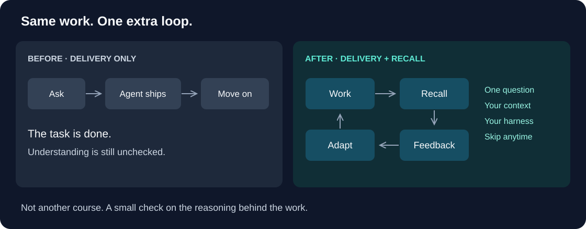
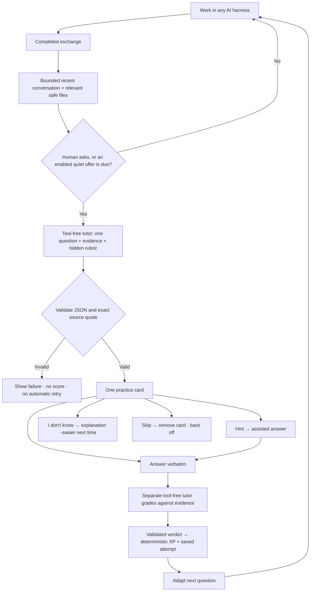
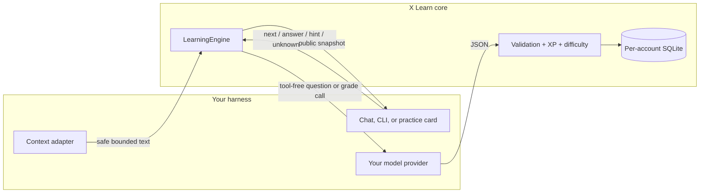

# X Learn

**Your agent gets the work done. You should understand it, too.**

A small learning loop inside your existing AI harness. No course setup. No manual source selection. One question about the work you just did.



## See it

```text
YOU     “Why did we add an idempotency key?”
AGENT   Explains it, updates the handler, tests the change.

        …later, one small practice card…

LEARN   A client retries the same payment request.
        What prevents a second charge?

YOU     “Store the key and return the earlier result.”
LEARN   Correct: the retry reuses the recorded outcome.  +10 XP

        [ Hint ]   [ I don't know ]   [ Skip ]
```

*Illustrative exchange, not a production screenshot or a measured learning outcome.*

## The loop



## Why add it?

| Without a learning loop | With X Learn |
| --- | --- |
| Agent completes the task | Task completion **plus a recall check** |
| Reading an explanation feels like understanding | Explain the reasoning in your own words |
| Next chat starts with no learning signal | Saved attempts inform the next difficulty |
| A quiz becomes another task | One optional question; Skip removes it |

The goal is to surface gaps while the work is still relevant. **XP is feedback, not proof of mastery.** This repo makes no measured retention claim.

## Try it — no API key

Requires **Node.js 22.13+**. No npm dependencies.

```sh
git clone https://github.com/pisakhov/x-learn.git
cd x-learn
node examples/demo.mjs
node --test
```

The demo uses a clearly labeled **scripted tutor**, runs the real engine, and deletes its temporary database. It does not demonstrate model quality.

## Bring your own harness



```js
import { LearningEngine } from './src/engine.mjs';

const learn = new LearningEngine({
  path: './private-data/account.sqlite', // isolate by authenticated account
  session: 'your-session-id',
  model: async (system, input, signal, maxTokens, selection) => {
    // Call YOUR provider with these prompts and NO tools.
    // Return { text: jsonText, model: 'provider/model', usage: optionalUsage }.
    // Enforce a timeout, honor signal, and reject truncated/error responses.
  },
});

learn.observe({
  label: 'Payments',
  topicKey: 'payments-project',
  source: safeRecentContext, // host supplies 40–12,000 characters
});
await learn.command({ action: 'next', id: crypto.randomUUID() });
const view = await learn.wait(); // render view.practice.attempts
// On shutdown: await learn.close();
```

This snippet is an adapter sketch; the [demo](examples/demo.mjs) is runnable. The model callback and `safeRecentContext` are yours to implement.

**Portable core, not a universal plug-in.** Any harness that can supply text, call a model, persist state, and render a response can implement the adapter. Python/Go harnesses can use a Node sidecar or port the [contract](docs/integration.md). No Pi, tmux, X Console, or specific provider is required by the core.

## Small rules, visible outcomes

| Action / result | XP | Next step |
| --- | ---: | --- |
| Correct | 10 | Two consecutive unaided correct answers raise difficulty |
| Partial | 5 | Step down one level |
| Hint + correct / partial | 3 / 1 | No unaided advancement |
| Incorrect | 0 | Step down one level |
| Uncertain | 0 | No difficulty increase |
| I don't know | 0 | Explain; reset to foundational |
| Skip | 0 | Hide card; pause offers for the configured interval |
| Dispute | Excluded | Remove that attempt from XP and adaptation |

Difficulty: **foundational → application → challenge**. No negative XP for not knowing or skipping. Disputes recompute totals, so displayed XP can decrease.

## Included / not included

| Included | Your adapter owns |
| --- | --- |
| Actual X Learn engine: SQLite, prompts, validation, adaptation | Context collection and secret filtering |
| One-question workflow, deterministic scoring, bounded jobs | Provider credentials, timeout, tool-free model call |
| Scripted demo and automated tests | Authentication, authorization, UI, scheduling |
| Visual explanation and integration contract | Production deployment and cross-harness testing |

[Integration & privacy](docs/integration.md) · [Source & limitations](docs/design.md) · [MIT license](LICENSE)
