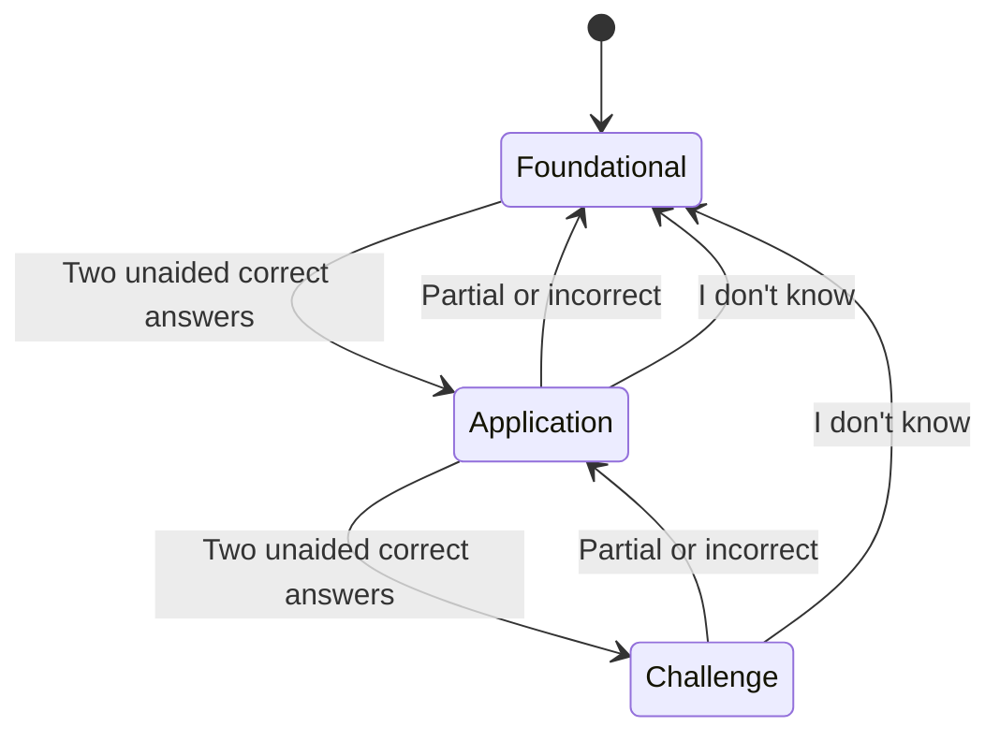

# Source and boundaries

`src/engine.mjs` is the X Learn engine extracted from the X runtime, not a reimplementation or a complete console export. Only code was copied—no accounts, transcripts, databases, credentials, host configuration, or private UI assets.

The original harness adapter and authenticated console UI are deliberately not included. This repository adds portable documentation, a scripted demonstration and focused tests.

## Trust separation

```text
Coding agent          Tutor call                  Deterministic engine
────────────          ──────────                  ────────────────────
Does the work         Writes one question         Checks shape + quote
Forwards human text   Grades against rubric       Calculates XP
Cannot choose XP      Has no execution tools      Persists attempts
```

Grounding validation checks that the evidence is an exact contiguous source quote (at least 12 characters). That catches fabricated quotations, **not every misleading question or incorrect grade**. The grader receives the stored evidence, question, rubric and answer—not the full project. Insufficient evidence should produce `uncertain`; the user can dispute a grade.

## Adaptation



Hints/assistance and uncertain grades reset the advancement streak. Skipped and disputed attempts do not drive adaptation. Difficulty history is grouped by the host's `topicKey` (the original adapter used a workspace key), not a proven semantic skill model. XP is account-wide; displayed cards are session-scoped.

## Compatibility code

The extracted engine retains older `courses`/map APIs and their spaced-review calculations so its storage format remains intact. They are **not** the recommended integration. This repo documents the current `practice` workflow: no maps, no manual source selection. Do not describe its practice loop as a validated spaced-repetition system.

The engine snapshots one JSON state document in SQLite transactions. It bounds jobs, request deduplication and history; it is not designed as a high-throughput multi-tenant service. At 10,000 attempts it refuses new questions. Plan private export/retention management before reaching that limit.

## Evidence, not promises

| Verified here | Not established here |
| --- | --- |
| Core runs without a harness SDK | Drop-in support for every harness |
| Scripted question/answer exercises actual state transitions | Real-model question quality |
| Tests cover grounding, scoring, persistence and key failure paths | Complete security audit or all concurrency interleavings |
| Prompts and deterministic rules are inspectable | Measured retention gains or mastery |
